# Architecture: one integrated data journey

Every layer consumes the previous layer's governed output, and the app's decisions flow back into the model.
There are no copies outside Unity Catalog and no side channels.

```mermaid
flowchart LR
  subgraph SRC["Altura systems of record (synthetic extracts)"]
    SAP["SAP: MARA, LFA1, ZQM_SRC_QUAL (PPAP / approved sources), STPO (BOM), EKPO (POs)"]
    MES["MES: coating-line batch runs (pilot, trial, production)"]
    PLM["PLM: NPI register + stage gates G0-G5"]
    EDI["OEM EDI (DELFOR): weekly program demand"]
    COM["Commercial: launch post-mortems"]
  end
  SRC -->|"CSV / JSON drops"| VOL["UC Volume<br/>landing/"]

  subgraph LF["Lakeflow Spark Declarative Pipeline (serverless)"]
    BZ["Bronze: 12 Auto Loader streaming tables"]
    SV["Silver: conformed entities + expectations<br/>SCD2 supplier qualification (AUTO CDC)"]
    GD["Gold MVs: launch portfolio, yield profile,<br/>launch x component supply"]
    BZ --> SV --> GD
  end
  VOL --> BZ

  subgraph ML["ML + GenAI (MLflow, Unity Catalog)"]
    YM["npi_yield_gap_model @champion"]
    RM["npi_launch_risk_model @champion"]
    SC["Scoring job: features (shared code), what-if effects of committed actions, explanations"]
    BR["ai_query briefs (GPT-5.5, JSON schema)<br/>prompt in MLflow Prompt Registry"]
    AG["Mitigation Advisor agent (Claude Sonnet 5.5)<br/>Model Serving, OBO auth, MLflow traces + eval"]
  end
  GD --> SC
  YM --> SC
  RM --> SC
  SC --> G2["Gold serving tables (CDF):<br/>risk scores, component readiness,<br/>ramp curve, risk history"]
  G2 --> BR --> G3["gold_launch_briefs"]

  subgraph UC["Unity Catalog governance"]
    MV["Metric views: readiness / component / history KPIs"]
    ABAC["ABAC: mask supplier prices, row filter by region<br/>(persona entitlements)"]
    LIN["Lineage, tags, certification, PK/FK, audit"]
  end
  G2 --> MV
  GD --> MV
  MV --> GN["Genie Agent<br/>(benchmarked 12/12)"]

  subgraph LB["Lakebase (serverless Postgres, registered in UC)"]
    SYN["serving.* synced tables"]
    OPS["ops.mitigation_actions / gate_signoffs (OLTP)"]
  end
  G2 -->|"synced tables (triggered)"| SYN
  G3 -->|"synced table"| SYN

  APP["Databricks App (AppKit, Altura-themed)<br/>Portfolio | Launch | Action Center | Advisor | Ask the Data"]
  SYN --> APP
  GN --> APP
  AG --> APP
  APP -->|"approve / commit actions"| OPS
  OPS -->|"Lakehouse Sync (CDC)"| LBH["UC: lb_mitigation_actions_history"]
  LBH -->|"table-update trigger"| JOB["Lakeflow Job: rescore-on-action"]
  JOB --> SC
  AG -.->|"tools: SQL on gold, what-if with UC models, Genie"| G2
```

## Layer-by-layer

| Stage | Asset(s) | Code | Evidence |
|---|---|---|---|
| **Lakeflow ingest** | SDP `npi-launch-readiness-ingest`: 12 bronze streaming tables (Auto Loader), 13 silver datasets with expectations, **AUTO CDC SCD Type 2** supplier qualification, 3 gold MVs | `src/pipelines/npi_ingest/transformations/*.sql`, `resources/npi_ingest.pipeline.yml` | `notebooks/01_*.ipynb` (landing), `evidence/job_run_daily_refresh.json` |
| **Unity Catalog** | Tags + certification, column comments, PK/FK, 3 **metric views**, **ABAC** column mask + row filter driven by a persona entitlements table, lineage | `notebooks/02_unity_catalog_governance.py`, `src/sql/metric_views.sql` | `notebooks/02_*.ipynb` (persona toggle proof, lineage query) |
| **ML** | Yield-gap regression + ramp-failure classifier, temporal holdout, UC registry `@champion`, SHAP/linear explanations, $ back-test | `notebooks/03_train_models.py`, `src/npi/features.py` | `notebooks/03_*.ipynb` |
| **Scoring + closed loop** | Applies committed Lakebase actions as feature effects, re-scores, publishes CDF gold tables | `notebooks/04_score_launches.py` | `notebooks/04_*.ipynb`, `notebooks/09_*.ipynb` |
| **GenAI (batch)** | `ai_query` steering-committee briefs, JSON-schema output, playbook-constrained, quality gate | `notebooks/06_genai_launch_briefs.py` | `notebooks/06_*.ipynb` |
| **GenAI (agent)** | Mitigation Advisor (MLflow ResponsesAgent), 5 tools including **what-if re-scoring with UC models**, OBO auth, MLflow Tracing, `mlflow.genai.evaluate` with 6 scorers | `src/npi/agent.py`, `notebooks/08_mitigation_advisor_agent.py` | `notebooks/08_*.ipynb`, `evidence/agent_eval.md` |
| **Lakebase** | Project `npi-readiness`; UC catalog `npi_ops_lakebase`; 6 synced tables; OLTP `ops` schema; **Lakehouse Sync** back to UC | `notebooks/05_lakebase_setup.py`, `tools/grant_app_access.py` | `notebooks/05_*.ipynb`, `notebooks/09_*.ipynb` |
| **Genie Agent** | "Altura BTD - NPI Launch Readiness" on metric views + instructions + example SQL + 12 benchmarks | `notebooks/07_genie_agent.py` | `notebooks/07_*.ipynb`, `evidence/genie_benchmarks.md` |
| **Databricks App** | `npi-control-tower` (AppKit/React + Express): Lakebase reads/writes, Genie (OBO), Advisor (OBO), Jobs status | `npi-control-tower/` | App URL in README, `evidence/app_api_smoke.md` |
| **Orchestration** | Jobs: daily refresh, **event-driven re-score on action** (table-update trigger), monthly retrain | `resources/npi_jobs.yml` | `evidence/job_run_*.json` |
